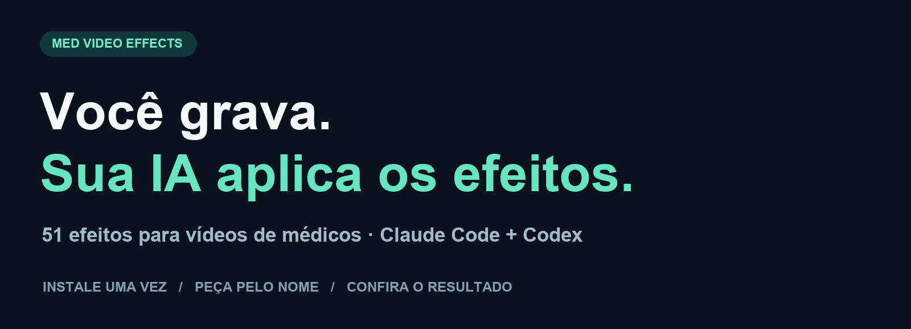
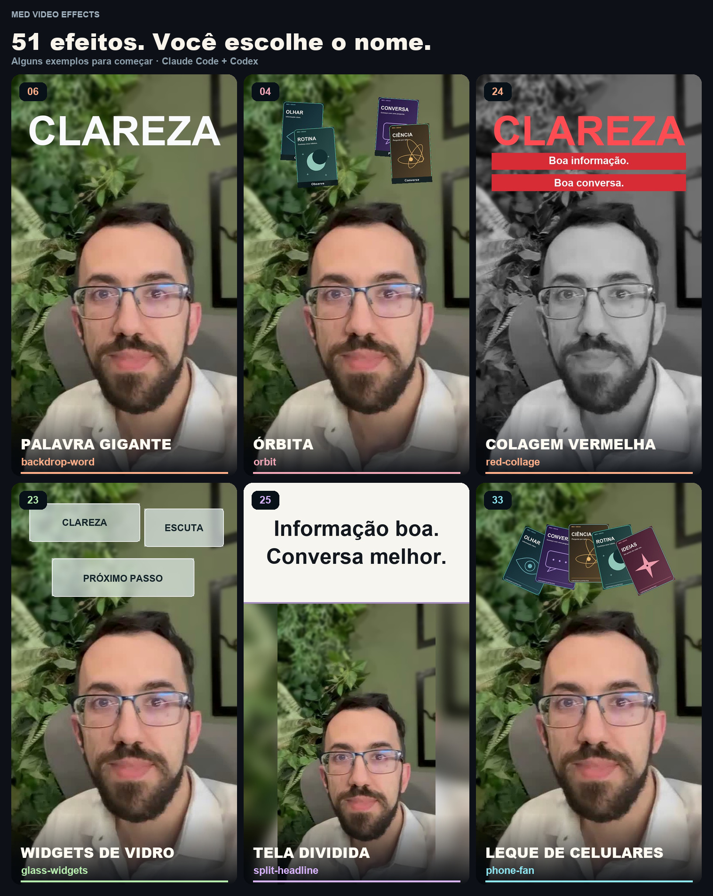

<div align="center">



**51 efeitos para seus vídeos. Peça pelo nome à sua IA.**

[Escolher um efeito](docs/CATALOGO.md) · [Guia avançado](docs/AVANCADO.md)

</div>

## 1. Peça para instalar

Copie e cole no **Claude Code** ou **Codex**:

```text
Instale a skill deste repositório no meu computador:
https://github.com/JVLegend/med-video-effects

Leia o SKILL.md e instale os programas necessários, incluindo
Python, Git e FFmpeg, se estiverem faltando. Prepare o ambiente
local e confirme que está pronto para editar meus vídeos.
```

Faça isso uma vez. Use uma IA com acesso aos arquivos e programas do seu computador.

## 2. Envie seu vídeo e peça o efeito

```text
Use o efeito Título em caixa nos primeiros 3 segundos,
com a frase “Leve suas dúvidas para a consulta”.
Preserve minha voz e gere uma prévia.
```

Ou simplesmente:

```text
Coloque o efeito Órbita no meu vídeo, de 4 a 7 segundos.
```

**[Veja os 51 efeitos e escolha pelo nome →](docs/CATALOGO.md)**

## Alguns exemplos



**Gostou de mais de um?** Peça à IA para combinar efeitos em momentos diferentes.

```text
Abra com Título em caixa, use Órbita de 4 a 7 segundos
e termine com Checklist. Mostre uma prévia antes de exportar.
```

<details>
<summary>Ver exemplos animados</summary>


</details>

O vídeo é processado no seu computador. O original é preservado e nada é publicado automaticamente. Revise o resultado antes de compartilhar.

[Instalação manual, comandos e soluções de problemas](docs/AVANCADO.md) · [Licença do código](LICENSE) · [Imagens de exemplo](assets/README.md)

Criado por [João Victor · @JVLegend](https://github.com/JVLegend).

<!-- #Saude #Tecnologia #JoaoVictor -->
