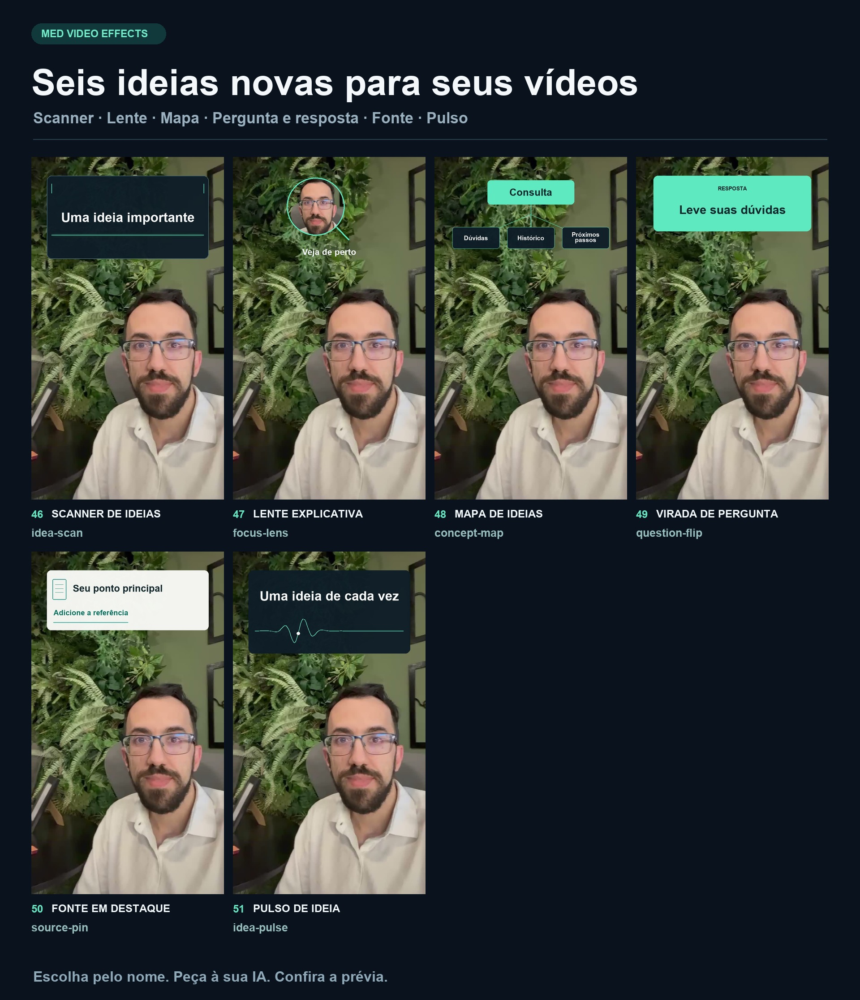
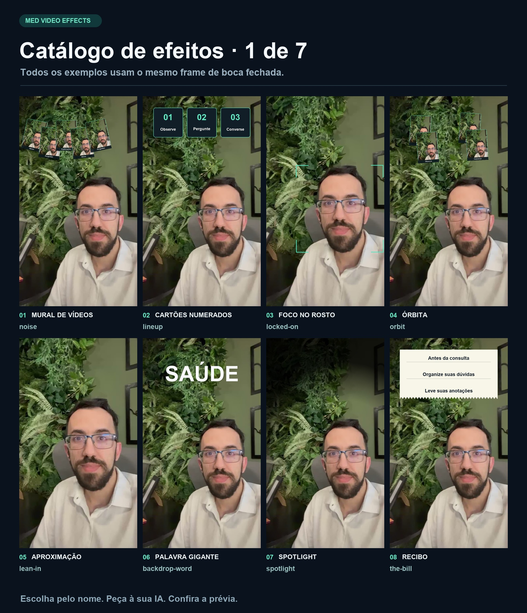
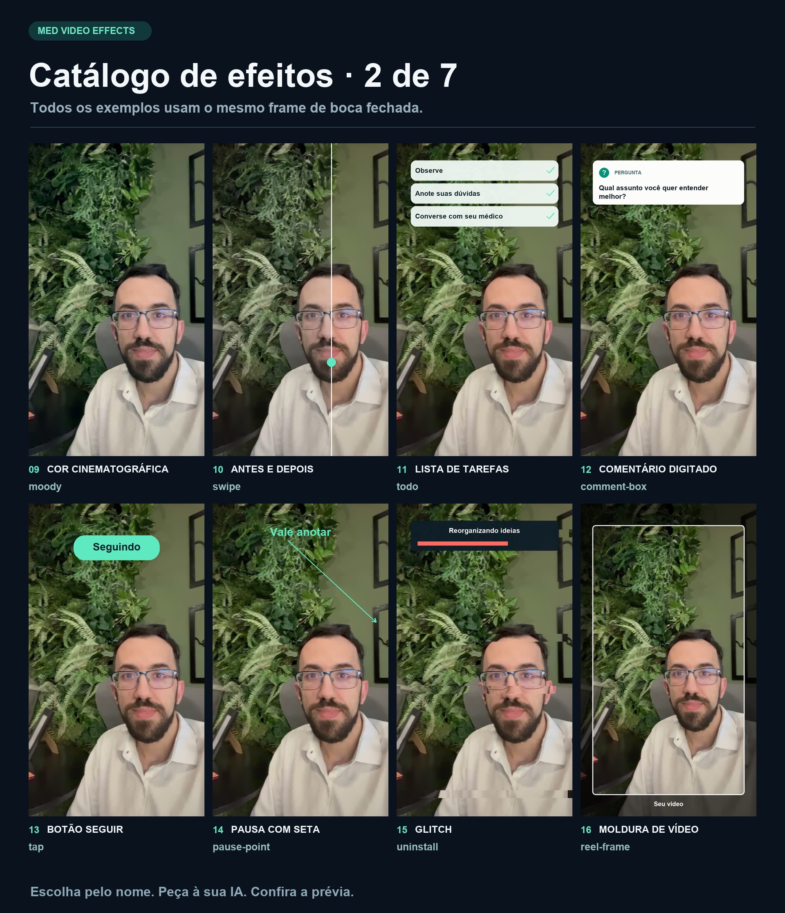
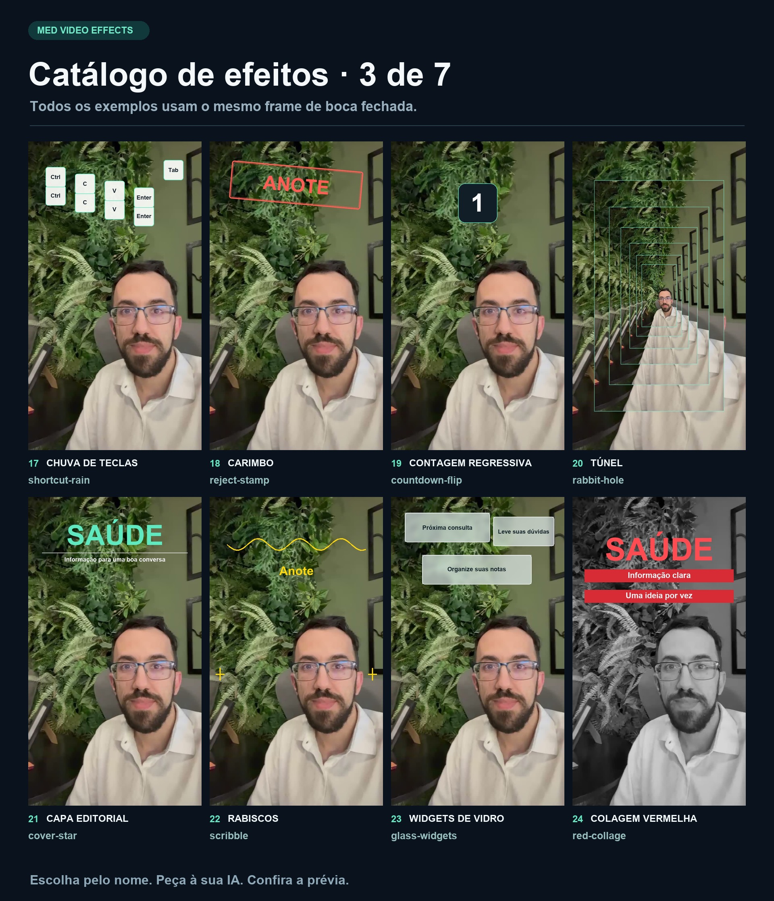
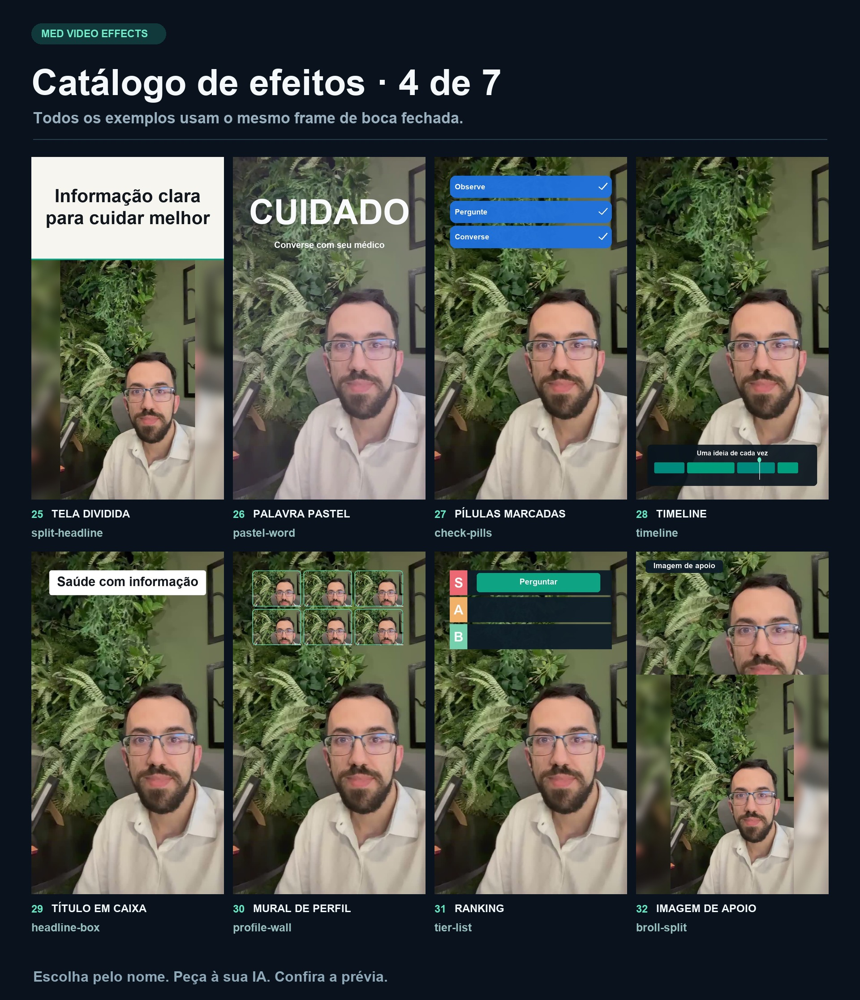
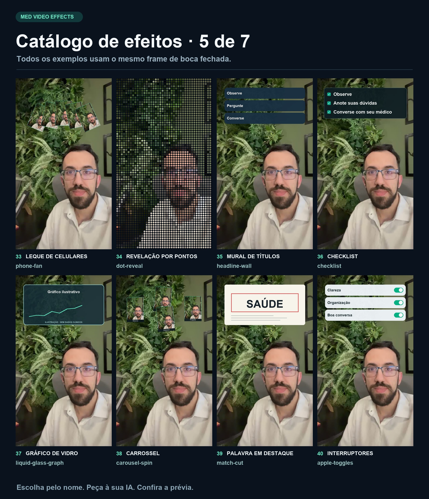
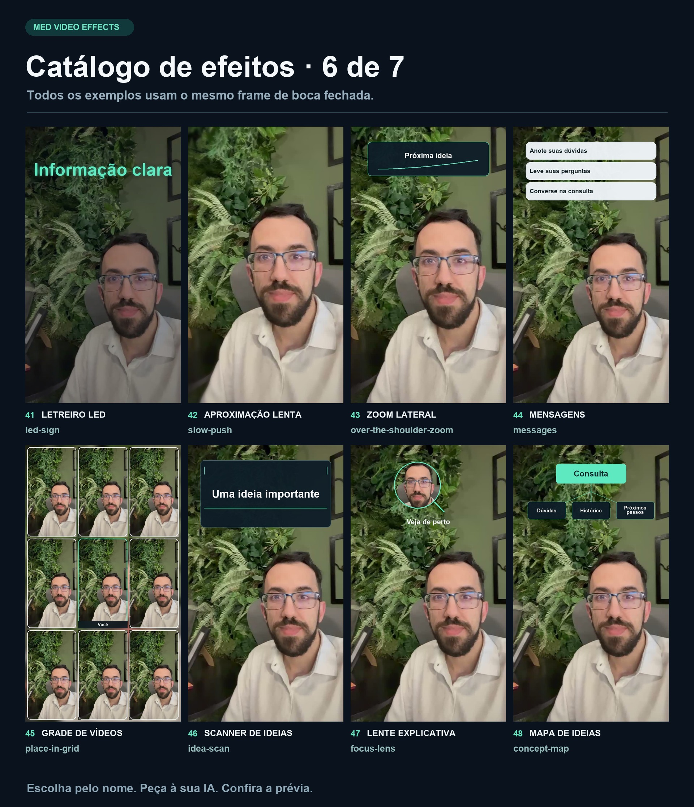
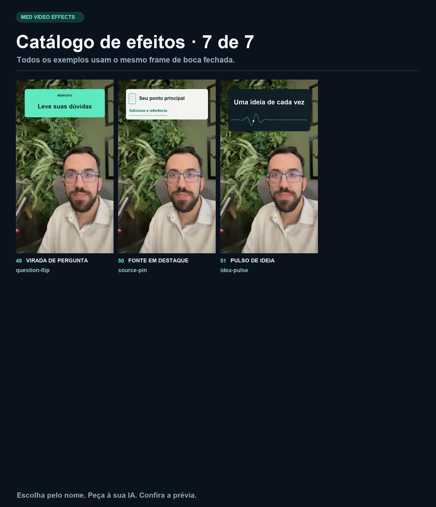

# Escolha seu efeito

#Saude #Tecnologia

Escolha um nome e peça à sua IA: **“Use o efeito Órbita no meu vídeo, de 3 a 6 segundos.”**

[Voltar ao início](../README.md) · [Opções avançadas](AVANCADO.md)

São versões locais dos 51 estilos. Cartões usam suas imagens, quando fornecidas; sem elas, usam um frame do próprio vídeo. Os layouts são adaptados ao espaço disponível e não fazem recorte semântico da pessoa.

| Nº | Peça por este nome | Nome técnico | O que acontece |
|---|---|---|---|
| 1 | Mural de vídeos | `noise` | Cartões de vídeo se acumulam acima do apresentador. |
| 2 | Cartões numerados | `lineup` | Até três cartões entram em sequência. |
| 3 | Foco no rosto | `locked-on` | Cantos de enquadramento acompanham uma aproximação suave. |
| 4 | Órbita | `orbit` | Cartões circulam em uma órbita no espaço acima do rosto. |
| 5 | Aproximação | `lean-in` | Uma aproximação rápida enfatiza a fala. |
| 6 | Palavra gigante | `backdrop-word` | Uma palavra grande surge no espaço acima do rosto. |
| 7 | Spotlight | `spotlight` | O ambiente escurece ao redor do apresentador. |
| 8 | Recibo | `the-bill` | Uma nota de papel se desenrola com seus pontos. |
| 9 | Cor cinematográfica | `moody` | Contraste discreto e sombras frias. |
| 10 | Antes e depois | `swipe` | Um divisor revela a mudança de cor. |
| 11 | Lista de tarefas | `todo` | Uma lista recebe marcações em sequência. |
| 12 | Comentário digitado | `comment-box` | Uma pergunta é digitada em um cartão. |
| 13 | Botão seguir | `tap` | Um botão muda de Seguir para Seguindo. |
| 14 | Pausa com seta | `pause-point` | O quadro congela e uma seta destaca um ponto. |
| 15 | Glitch | `uninstall` | Uma barra avança enquanto faixas deslocam a imagem. |
| 16 | Moldura de vídeo | `reel-frame` | A gravação se acomoda em um cartão vertical. |
| 17 | Chuva de teclas | `shortcut-rain` | Teclas animadas caem no espaço acima do rosto. |
| 18 | Carimbo | `reject-stamp` | Um carimbo colorido aparece inclinado. |
| 19 | Contagem regressiva | `countdown-flip` | Números 3, 2 e 1 preparam o próximo assunto. |
| 20 | Túnel | `rabbit-hole` | Cópias do quadro criam um túnel visual. |
| 21 | Capa editorial | `cover-star` | Manchete e subtítulo formam uma capa. |
| 22 | Rabiscos | `scribble` | Traços de marcador aparecem ao redor do enquadramento. |
| 23 | Widgets de vidro | `glass-widgets` | Pequenos cartões translúcidos flutuam acima do rosto. |
| 24 | Colagem vermelha | `red-collage` | Imagem monocromática e faixas vermelhas de texto. |
| 25 | Tela dividida | `split-headline` | Um título abre espaço no alto da imagem. |
| 26 | Palavra pastel | `pastel-word` | Lavanda, palavra de destaque e cartão de perfil. |
| 27 | Pílulas marcadas | `check-pills` | Etiquetas azuis recebem marcações uma a uma. |
| 28 | Timeline | `timeline` | Uma linha de edição acompanha o avanço do trecho. |
| 29 | Título em caixa | `headline-box` | Uma frase entra em uma caixa branca. |
| 30 | Mural de perfil | `profile-wall` | Uma grade de cartões ocupa o espaço acima do rosto. |
| 31 | Ranking | `tier-list` | Um item se move para a primeira faixa de uma classificação. |
| 32 | Imagem de apoio | `broll-split` | Uma imagem de apoio ocupa a parte superior da tela. |
| 33 | Leque de celulares | `phone-fan` | Cartões de celular se abrem em leque. |
| 34 | Revelação por pontos | `dot-reveal` | Pontos formam a imagem e dão lugar ao quadro nítido. |
| 35 | Mural de títulos | `headline-wall` | Manchetes se acumulam em cartões. |
| 36 | Checklist | `checklist` | Uma lista escura recebe marcações. |
| 37 | Gráfico de vidro | `liquid-glass-graph` | Um gráfico ilustrativo se desenha em cartão translúcido. |
| 38 | Carrossel | `carousel-spin` | Cartões giram e desaceleram no espaço superior. |
| 39 | Palavra em destaque | `match-cut` | Cartões mudam mantendo uma palavra no mesmo lugar. |
| 40 | Interruptores | `apple-toggles` | Chaves visuais são ligadas uma a uma. |
| 41 | Letreiro LED | `led-sign` | Uma frase luminosa se acende no alto da imagem. |
| 42 | Aproximação lenta | `slow-push` | Zoom gradual e fundo mais suave. |
| 43 | Zoom lateral | `over-the-shoulder-zoom` | A imagem se aproxima de lados alternados com cartões. |
| 44 | Mensagens | `messages` | Notificações aparecem em sequência. |
| 45 | Grade de vídeos | `place-in-grid` | O apresentador entra no centro de uma grade 3 por 3. |
| 46 | Scanner de ideias | `idea-scan` | Uma faixa luminosa revela a palavra principal. |
| 47 | Lente explicativa | `focus-lens` | Uma lente amplia um detalhe real da sua imagem. |
| 48 | Mapa de ideias | `concept-map` | Um tema se conecta a três conceitos em sequência. |
| 49 | Virada de pergunta | `question-flip` | Um cartão gira de pergunta para resposta. |
| 50 | Fonte em destaque | `source-pin` | Uma referência ganha cartão e sublinhado animado. |
| 51 | Pulso de ideia | `idea-pulse` | Uma onda luminosa destaca uma frase. |

## Seis efeitos criativos novos



Peça “Use Mapa de ideias com Consulta, Dúvidas, Histórico e Próximos passos”. Para Virada de pergunta, forneça a pergunta e a resposta; para Fonte em destaque, forneça o ponto e a referência.

## Galeria 1



## Galeria 2



## Galeria 3



## Galeria 4



## Galeria 5



## Galeria 6



## Galeria 7



## Um pedido com vários efeitos

```text
Use Título em caixa no início, Órbita de 4 a 7 segundos
e Checklist de 10 a 14 segundos. Preserve minha voz e gere uma prévia.
```

Contadores, gráficos e rankings são recursos visuais. Forneça seus textos, dados e imagens; os exemplos não demonstram resultados clínicos.
